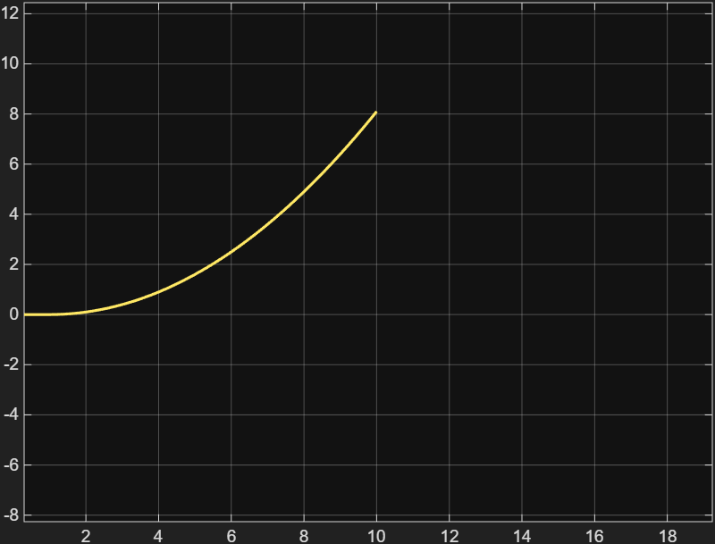
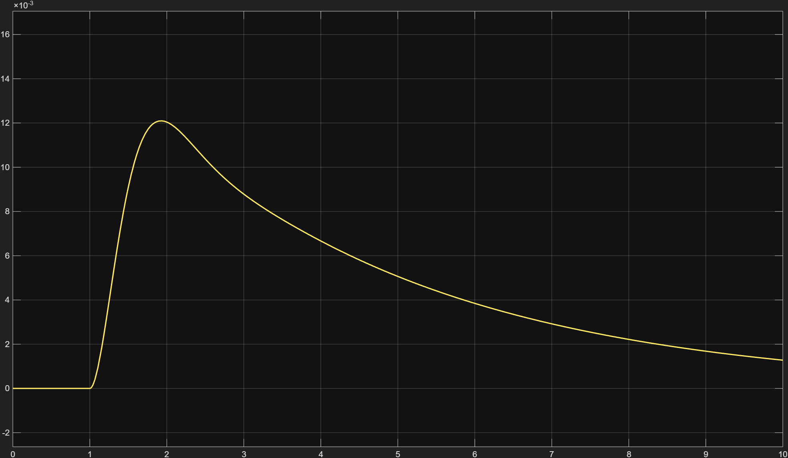

# Drone Stabilisation with a PID Controller (MATLAB Simulink)

The following simulation (via MATLAB Simulink) presents the effects of using a PID controller on a drone impacted by a sudden disruption (in this case, a gust of wind).

There are two simulations presented for the two cases. The first case, `drone_nocontroller`, presents the course of the drone's angle before and after the gust of wind. The graph associated with this case shows clear destabilisation, which is not reduced in any way without the controller.

The second case, `drone_controller`, shows the impact of a PID controller on the drone's course.

## The model
The drone is modelled as tilting in one direction (roll), using Newton's second law for rotation:

> torque = moment of inertia × angular acceleration

- **Moment of inertia:** 0.005 kg·m² (a value assumed, typical for a small drone)
- **Gust of wind:** a constant torque of 0.01 N·m starting at t = 1 s
- Two integrators turn the angular acceleration into angular speed, and then into the tilt angle.

## The controller
In `drone_controller`, the tilt angle is fed back and compared to the target angle (0°, level). The PID controller turns this difference (the error) into a counter-torque:

- **P (proportional):** reacts to how far the drone is tilted 
- **I (integral):** removes small errors that remain over time
- **D (derivative):** reacts to how fast the drone is tilting, preventing it from wobbling

Values used: P = 0.08, I = 0.02, D = 0.028

## Results

**Case 1: no controller.** The drone keeps tilting further after the gust and never recovers.

**Case 2: PID controller.** The drone tilts by about [X]° and returns to level within about [Y] seconds.

## Effect of each part of the controller
- **D = 0:** the drone oscillates and never settles, since nothing damps the motion.
- **I = 0:** the drone recovers but stays slightly tilted.
- **Larger P:** faster response, but more overshoot.

## How to run
1. Open `drone_nocontroller.slx` or `drone_controller.slx` in Simulink.
2. Press **Run**.
3. Double-click the Scope block to see the tilt angle over time.

## Tools
MATLAB & Simulink (MATLAB Online)
